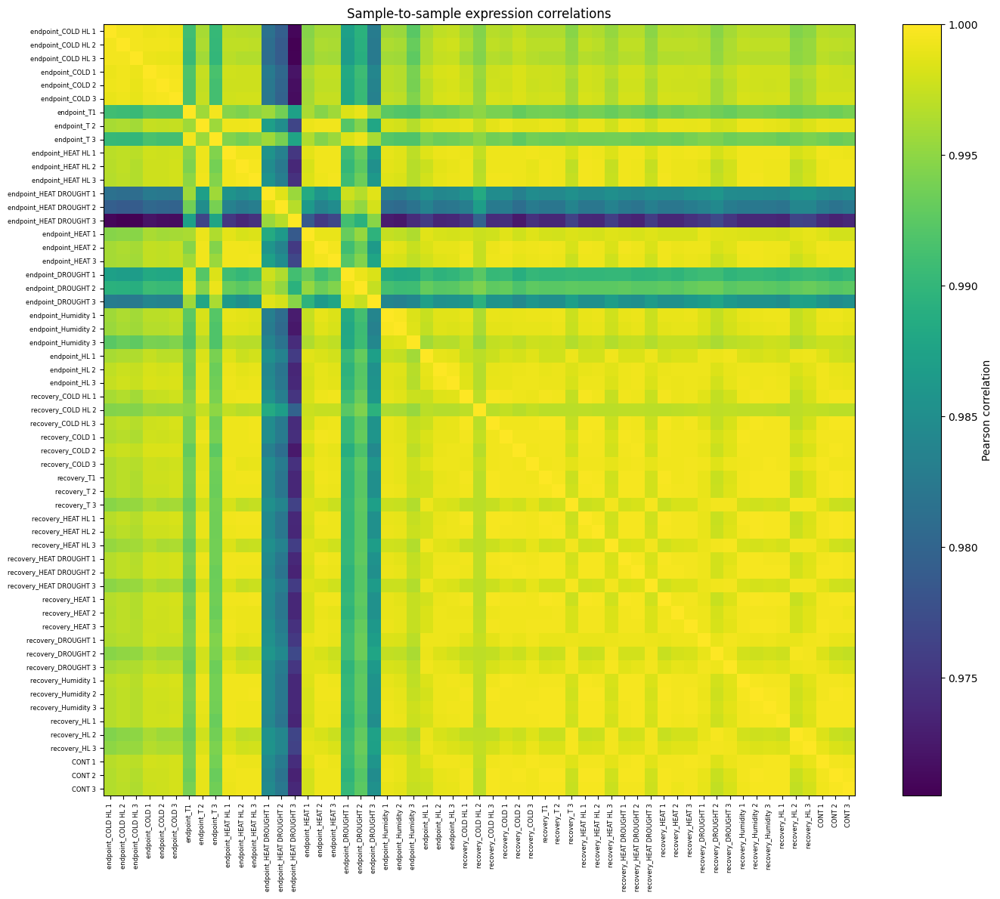
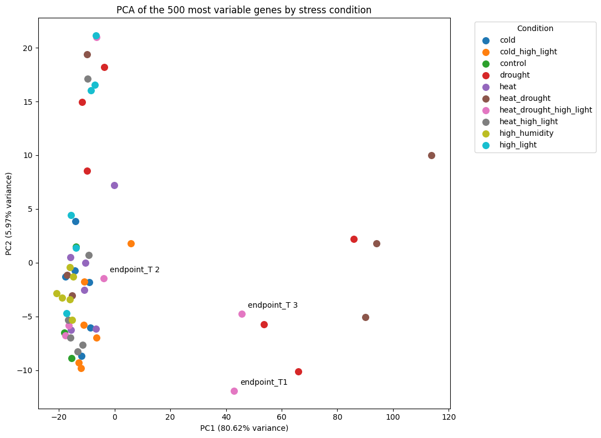
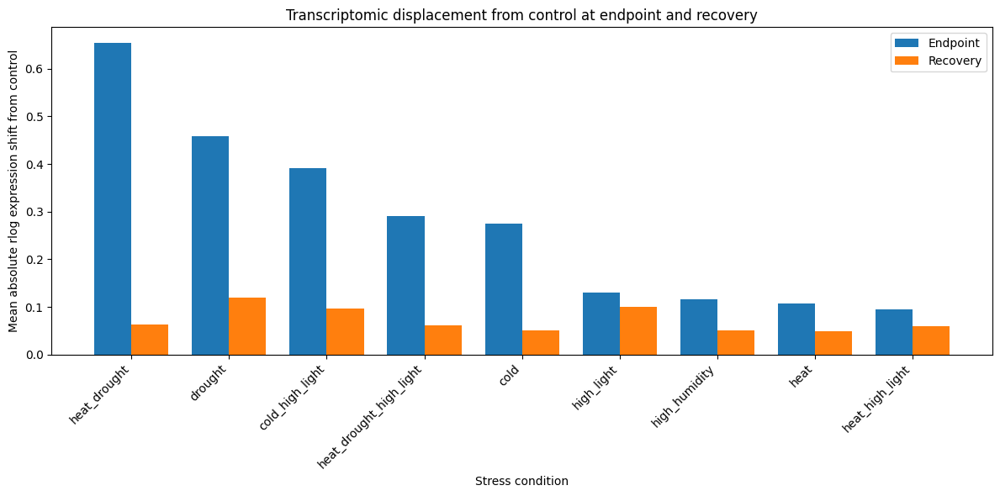
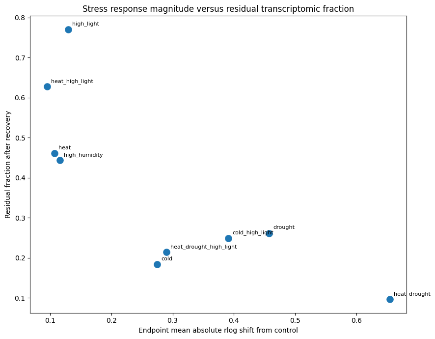
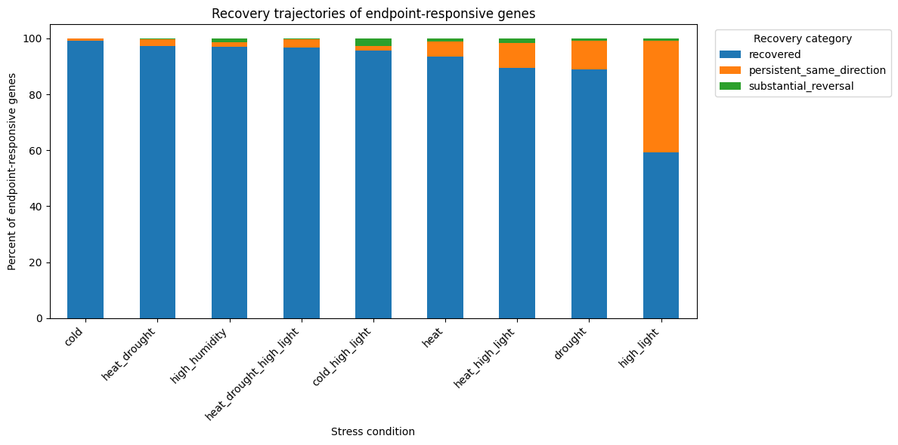
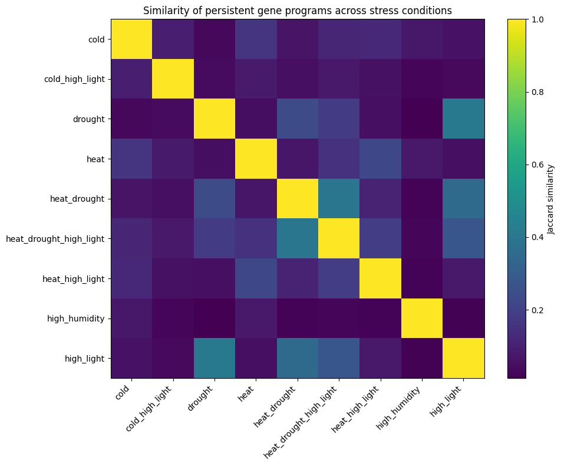
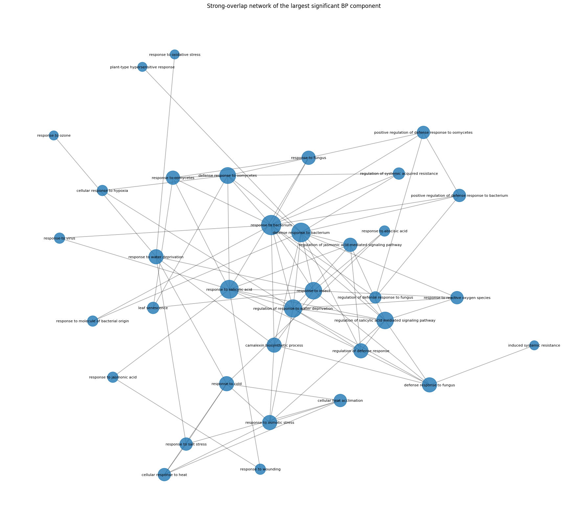
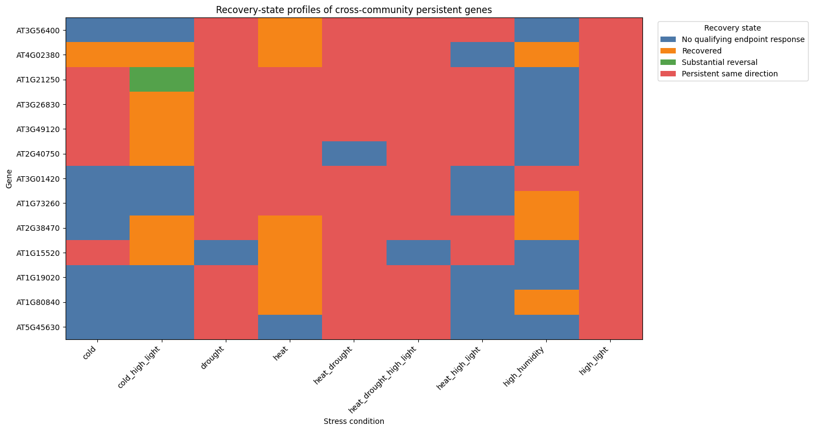

# Arabidopsis Stress Recovery Atlas

**A computational analysis and reproducible analytical data platform for context-dependent transcriptomic recovery after abiotic stress in _Arabidopsis thaliana_.**

**Author:** Swapnanil Sinha  
**Primary dataset:** NCBI GEO `GSE226105` · BioProject `PRJNA938512`  
**Scientific analysis:** Complete  
**Analytical data platform:** Complete  
**Automated test suite:** 85 tests passing

> **What remains after the stress is removed?**

Most stress-transcriptomics analyses focus on the acute response: which genes change under stress, how strongly they change, and which biological functions are enriched.

This project asks the complementary question:

> **After plants return to standard conditions, which transcriptomic changes disappear, which remain, and how does that residual state differ across stresses?**

Using the public _Arabidopsis thaliana_ RNA-seq experiment `GSE226105`, the project compares stress endpoint and recovery states across nine single and combined abiotic-stress conditions.

The work has two connected layers:

1. **Scientific analysis** — exploratory transcriptomic analysis, quality control, recovery classification, cross-stress persistence, functional interpretation, comparison with published DESeq2 recovery results, and robustness analysis.
2. **Reproducible analytical platform** — tested Python modules, centralized configuration and source handling, canonical analytical tables, a relational SQLite database, SQL queries, automated validation, pipeline orchestration, and database-driven reporting.

The central scientific result is not that the transcriptome fails to recover. The data are broadly consistent with recovery after stress. Instead, broad recovery coexists with smaller residual RNA-abundance patterns whose size, direction, recurrence, and functional composition differ strongly among stress conditions.

> **Scope note:** this repository analyzes the processed rlog expression matrix and published supplementary differential-expression results from the source study. It does not process FASTQ files and does not replace formal count-based differential-expression analysis.

---

## Contents

- [Research question](#research-question)
- [Dataset and experimental design](#dataset-and-experimental-design)
- [Scientific analysis](#scientific-analysis)
- [Key analytical definitions](#key-analytical-definitions)
- [Main findings](#main-findings)
- [Functional interpretation](#functional-interpretation)
- [GO redundancy and overlap network](#go-redundancy-and-overlap-network)
- [Published DESeq2 concordance](#published-deseq2-concordance)
- [Robustness analysis](#robustness-analysis)
- [Interpretation guardrails](#interpretation-guardrails)
- [Analytical data platform](#analytical-data-platform)
- [Canonical analytical tables](#canonical-analytical-tables)
- [Relational database](#relational-database)
- [Testing and validation](#testing-and-validation)
- [Reporting layer](#reporting-layer)
- [Repository structure](#repository-structure)
- [Reproducing the project](#reproducing-the-project)
- [Scientific notebooks](#scientific-notebooks)
- [Generated outputs](#generated-outputs)
- [Limitations](#limitations)
- [Future scientific work](#future-scientific-work)
- [Data provenance and attribution](#data-provenance-and-attribution)
- [Citation and license](#citation-and-license)
- [Final perspective](#final-perspective)

---

# Research question

The project is built around one main question:

> **How does the _Arabidopsis thaliana_ transcriptome differ between stress endpoint and recovery states, and which residual expression patterns are shared versus context-dependent across stress conditions?**

This is divided into six connected scientific questions:

1. Is the processed expression matrix internally consistent enough for transcriptome-level exploratory analysis?
2. How far is each stress condition displaced from control at endpoint, and how much displacement remains in the recovery cohort?
3. Which qualifying gene-level endpoint responses recover, remain persistently displaced in the same direction, or substantially reverse?
4. Which persistent genes are stress-specific, and which recur across multiple stress conditions?
5. Are broadly persistent genes associated with coherent biological functions?
6. Are the main patterns consistent with the available published DESeq2 recovery results, and do they remain recognizable when the empirical response threshold is changed?

The working expectation was that different stresses would show different degrees of recovery rather than a simple relationship in which larger endpoint responses necessarily produce larger residual states.

---

# Dataset and experimental design

## Primary dataset

| Item | Value |
|---|---|
| Organism | _Arabidopsis thaliana_ |
| Genotype | wild-type Col-0 |
| Tissue | rosette leaves |
| GEO accession | `GSE226105` |
| BioProject | `PRJNA938512` |
| Processed matrix | `GSE226105_rLog-Normalized_counts.csv` |
| Gene rows | 28,775 |
| Expression samples | 57 |
| Informative genes used for variation-based analyses | 26,118 |
| All-zero genes excluded from variation-based analyses | 2,657 |

The processed matrix contains one gene-identifier column and 57 rlog-transformed expression columns.

## Experimental states

The experiment contains:

- **3 control samples**
- **27 endpoint samples**
- **27 recovery samples**

There are three biological replicates for every stress-state combination.

The nine standardized stress conditions are:

```text
cold
cold_high_light
drought
heat
heat_drought
heat_drought_high_light
heat_high_light
high_humidity
high_light
```

The abbreviated raw condition label `T` corresponds to:

```text
heat + drought + high light
```

## Endpoint and recovery are separate cohorts

The experiment does **not** repeatedly measure the same plants.

Endpoint and recovery samples are parallel age-matched day-18 cohorts:

- endpoint plants experienced stress during the final three days before harvest;
- recovery plants experienced the corresponding stress earlier, returned to standard conditions for three days, and were harvested at the same age.

The analysis therefore compares **group-level experimental states**, not within-plant longitudinal trajectories.

---

# Scientific analysis

The scientific workflow follows a deliberate sequence:

```text
processed expression matrix
        ↓
experimental-design reconstruction
        ↓
expression-matrix audit
        ↓
sample-level quality control
        ↓
endpoint and recovery displacement from control
        ↓
gene-level recovery classification
        ↓
cross-stress persistence
        ↓
functional annotation and GO enrichment
        ↓
GO-term overlap and descriptive network analysis
        ↓
comparison with published DESeq2 recovery results
        ↓
response-floor and functional robustness analysis
```

Each later step depends on assumptions checked earlier. The processed matrix is not treated as automatically correct simply because it is publicly available.

## Expression-matrix audit

The initial analysis verifies:

- matrix dimensions;
- gene identifiers;
- numeric expression columns;
- missing and infinite values;
- all-zero rows;
- repeated numerical profiles;
- sample labels;
- experimental state;
- stress condition;
- replicate number;
- component stressors.

The reconstructed experimental design contains exactly 3 control, 27 endpoint, and 27 recovery samples.

## Sample-level quality control

Quality control is performed on the **processed rlog matrix**, not on FASTQ reads.

The QC analysis includes:

- sample-wise expression distributions;
- transcriptome-wide Pearson correlations;
- within-group and between-group similarity;
- nearest-neighbor relationships;
- PCA using the 500 most variable genes;
- hierarchical clustering;
- PCA using all 26,118 informative genes.

Two endpoint samples received particular attention:

- `endpoint_T 2`, an atypical triple-stress endpoint replicate;
- `endpoint_HEAT DROUGHT 3`, which showed greater within-treatment variation among highly variable genes while retaining the expected treatment identity.

Neither sample was removed because the available evidence did not establish technical failure or clear misassignment.

### Sample-to-sample expression correlations



Shows transcriptome-wide Pearson correlation structure across all 57 samples and helps identify unusual similarity patterns.

### PCA of the 500 most variable genes



Shows the dominant sample structure across stress conditions and highlights the atypical position of `endpoint_T 2`.

---

# Key analytical definitions

## Informative gene

A gene with at least one non-zero rlog value across the 57 samples.

Genes equal to zero in every sample are excluded from variation-based analyses.

## Endpoint shift

For gene `g` under stress condition `s`:

```text
endpoint_shift(g, s) = mean(endpoint_s) - mean(control)
```

This measures how far the endpoint group lies from the untreated control baseline.

## Recovery shift

```text
recovery_shift(g, s) = mean(recovery_s) - mean(control)
```

This measures how far the recovery group remains from the same control baseline.

Signed shifts preserve direction relative to control. Absolute shifts are used when the question concerns magnitude rather than direction.

## Empirical response floor

Small differences in transformed expression should not automatically be treated as meaningful biological responses.

The primary exploratory response floor is derived from absolute pairwise differences among the three control replicates across all 26,118 informative genes:

```text
26,118 genes × 3 control-control pairs
= 78,354 control-derived differences
```

The primary threshold is the 95th percentile:

```text
p95 response floor = 0.342263 rlog units
```

A gene-condition endpoint response must satisfy:

```text
|endpoint_shift| >= response_floor
```

before entering the recovery classification.

The response floor is an **exploratory magnitude threshold**. It is not a p-value, not a formal differential-expression significance threshold, not a gene-specific variance model, and not a replacement for DESeq2.

## Comparative Reversibility Index

For qualifying endpoint responses:

```text
RI = 1 - |Recovery - Control| / |Endpoint - Control|
```

Interpretation:

- `RI ≈ 1`: recovery lies close to control relative to the endpoint state;
- `RI ≈ 0`: recovery displacement is similar in magnitude to endpoint displacement;
- `RI < 0`: recovery lies farther from control than the endpoint state.

Because endpoint and recovery samples are separate cohorts, this is a **comparative state index**, not a within-plant trajectory.

## Recovery categories

For genes with a qualifying endpoint response:

### Recovered

```text
|recovery_shift| < response_floor
```

### Persistent, same direction

```text
|recovery_shift| >= response_floor
and
sign(recovery_shift) == sign(endpoint_shift)
```

### Substantial reversal

```text
|recovery_shift| >= response_floor
and
sign(recovery_shift) != sign(endpoint_shift)
```

Genes without a qualifying endpoint response remain explicitly classified as `not_endpoint_eligible` rather than being mislabeled as recovered.

## Persistence breadth

Persistence breadth is the number of stress conditions in which a gene is classified as persistent in the same direction.

The primary high-breadth definition is:

```text
persistent in at least 4 of 9 stress conditions
```

This is an operational prioritization rule rather than a natural biological boundary.

---

# Main findings

## At a glance

| Result | Primary analysis |
|---|---:|
| Informative genes | 26,118 |
| Primary response floor | 0.342263 rlog |
| Genes persistent in at least one stress | 1,609 |
| Genes persistent in at least two stresses | 726 |
| High-breadth genes, persistence in at least four stresses | 206 |
| Directionally consistent among multi-stress persistent genes | 720 / 726 |
| Consistently above control among directionally consistent genes | 711 / 720 |
| Significant GO-Slim terms for the 206-gene set | 24 |
| Significant detailed Biological Process terms | 45 |
| Shared drought genes with published recovery DEGs | 348 |
| Shared published/exploratory records agreeing in direction after contrast harmonization | 354 / 354 |

## 1. The transcriptome is broadly recovery-oriented, but residual expression differs strongly by stress

Condition-level mean absolute displacement from control shows that endpoint response and recovery-state residual are not the same property.

| Stress | Endpoint mean absolute shift | Recovery mean absolute shift | Residual fraction |
|---|---:|---:|---:|
| heat+drought | 0.654 | 0.063 | 0.096 |
| drought | 0.458 | 0.120 | 0.262 |
| cold+high light | 0.391 | 0.097 | 0.249 |
| heat+drought+high light | 0.290 | 0.062 | 0.214 |
| cold | 0.275 | 0.050 | 0.184 |
| high light | 0.130 | 0.100 | 0.770 |
| high humidity | 0.116 | 0.051 | 0.443 |
| heat | 0.107 | 0.049 | 0.460 |
| heat+high light | 0.095 | 0.060 | 0.627 |

The residual fraction is a descriptive ratio and is interpreted alongside the absolute endpoint and recovery shifts.

Two conditions illustrate the contrast clearly:

- **heat+drought** has the largest endpoint displacement but a small residual fraction after recovery;
- **high light** has a much smaller endpoint displacement but a substantially larger residual fraction.

The appropriate conclusion is therefore:

> **Larger endpoint displacement does not consistently correspond to greater persistence after recovery.**

### Transcriptomic displacement from control



### Stress-response magnitude versus residual fraction



## 2. Gene-level recovery is strongly stress-dependent

At the primary p95 response floor:

| Condition | Endpoint eligible | Recovered | Persistent same direction | Substantial reversal |
|---|---:|---:|---:|---:|
| cold | 8,915 | 8,838 | 71 | 6 |
| cold+high light | 12,210 | 11,677 | 187 | 346 |
| drought | 11,942 | 10,613 | 1,240 | 89 |
| heat | 1,310 | 1,226 | 70 | 14 |
| heat+drought | 14,088 | 13,690 | 344 | 54 |
| heat+drought+high light | 8,609 | 8,323 | 255 | 31 |
| heat+high light | 814 | 729 | 72 | 13 |
| high humidity | 1,712 | 1,661 | 28 | 23 |
| high light | 1,950 | 1,154 | 779 | 17 |

For every condition, the recovery categories sum exactly to the number of qualifying endpoint responses.

Selected persistent fractions among qualifying endpoint responders:

```text
high light            39.95%
drought               10.38%
heat + high light      8.85%
heat                   5.34%
heat + drought         2.44%
cold                   0.80%
```

A condition can therefore have many endpoint-responsive genes yet retain only a small persistent fraction.



## 3. Most persistent genes are stress-specific, but a recurrent multi-stress component exists

Across the 26,118 informative genes:

```text
24,509 genes were never persistent
1,609 genes were persistent in at least one stress
```

Persistence breadth at the primary p95 floor:

| Persistence breadth | Number of genes |
|---|---:|
| 1 stress | 883 |
| 2 stresses | 350 |
| 3 stresses | 170 |
| 4 stresses | 126 |
| 5 stresses | 48 |
| 6 stresses | 17 |
| 7 stresses | 13 |
| 8 stresses | 2 |
| 9 stresses | 0 |

Thus, 883 of 1,609 persistent genes, or 54.9%, are stress-specific under the primary definition.

At the same time:

- 726 genes are persistent in at least two stress conditions;
- 376 are persistent in at least three;
- 206 satisfy the primary high-breadth definition of at least four stresses;
- 80 are persistent in at least five stresses.

## 4. Multi-stress persistence is exceptionally directionally coherent

Among the 726 genes persistent in at least two stresses:

```text
720 / 726 = 99.17%
```

show the same direction relative to control across every condition in which they are persistent.

Among those 720 directionally consistent genes:

```text
711 / 720 = 98.75%
```

remain **above control**.

Recurrent multi-stress persistence is therefore overwhelmingly associated with residual elevation of RNA abundance rather than a balanced mixture of positive and negative residual states.

## 5. Persistent-gene sharing is context-dependent

Examples of persistent genes shared with at least one other stress:

```text
heat+drought+high light    97.25%
heat+high light            97.22%
heat+drought               97.09%
drought                    53.63%
cold+high light            39.04%
```

Notable pairwise Jaccard similarities include:

```text
drought ↔ high light                       ~0.410
heat+drought ↔ heat+drought+high light     ~0.400
heat+drought ↔ high light                  ~0.351
```

The data therefore support neither one universal residual stress response nor nine completely separate responses. Instead, persistent expression contains both stress-specific and partially shared components.



---

# Functional interpretation

## Araport11 annotation

Genes were mapped to Araport11 functional descriptions at the locus level.

All 1,609 persistent genes received matched locus-level annotations.

The canonical Stage 2 gene table retains all 26,118 informative genes, including genes without an Araport match, rather than dropping unmatched genes.

## GO-Slim enrichment

GO-Slim enrichment uses the informative expression universe while restricting each GO aspect to genes that are actually annotatable in that branch.

The 206-gene high-breadth foreground produces:

```text
24 significant GO-Slim terms at BH FDR < 0.05
```

Selected enriched themes include:

| GO-Slim theme | Approx. enrichment |
|---|---:|
| response to biotic stimulus | 6.87× |
| response to external stimulus | 6.41× |
| response to abiotic stimulus | 3.93× |
| response to chemical | 3.86× |
| response to stress | 3.59× |
| response to endogenous stimulus | 3.27× |
| cell wall | 3.26× |
| signal transduction | 2.48× |
| response to light stimulus | 2.36× |
| kinase activity | 2.26× |
| plasma membrane | 2.14× |
| extracellular region | 1.91× |

The enrichment of biotic- and defense-related terms does **not** imply that the experiment applied biotic stress. Plant stress-response systems overlap extensively.

## Detailed Biological Process enrichment

Detailed Biological Process testing used 938 eligible terms after removal of very small background categories and the generic Biological Process root.

The analysis identified:

```text
45 significant Biological Process terms at BH FDR < 0.05
```

Prominent themes include responses to:

- salicylic acid;
- jasmonic acid;
- abscisic acid;
- water deprivation;
- osmotic stress;
- salt stress;
- cold;
- heat acclimation;
- oxidative stress;
- reactive oxygen species;
- hypoxia;
- bacterial and fungal stimuli;
- systemic acquired resistance;
- leaf senescence;
- camalexin biosynthesis.

These terms are strongly overlapping and should not be interpreted as 45 independent pathways.

---

# GO redundancy and overlap network

To avoid treating overlapping GO terms as independent discoveries, the project reconstructs the high-breadth genes supporting each significant Biological Process term and measures term overlap directly.

The 45 significant terms contain:

```text
388 term-gene memberships
120 unique high-breadth genes
```

Across all 990 term pairs:

```text
562 / 990 shared no foreground genes               56.8%
428 / 990 shared at least one foreground gene      43.2%
 88 / 990 had overlap coefficient >= 0.50           8.9%
 17 / 990 had overlap coefficient >= 0.75           1.7%
  9 / 990 had overlap coefficient = 1.00            0.9%
```

GO redundancy is therefore strong in some local groups but not global across the entire significant-term set.

## Strong-overlap network

A descriptive network connects two terms when:

```text
overlap coefficient >= 0.50
```

At the primary threshold:

```text
45 total significant terms
88 strong-overlap edges
39 terms participate in at least one strong edge
largest connected component = 35 terms
86 / 88 edges lie within that component
```

Weighted greedy modularity separates the largest connected structure into four descriptive functional groups centered broadly on:

1. pathogen / defense response;
2. defense signaling / hormone / redox / damage;
3. abiotic stress / acclimation;
4. specialized defense.

Primary modularity:

```text
Q ≈ 0.426
```

This is a network structure score, not a p-value and not evidence that the groups are statistically proven biological modules.

The network was also examined at overlap thresholds of 0.40, 0.50, and 0.60. The central connected structure remains recognizable while peripheral terms change as the criterion becomes stricter.



## Genes spanning several GO-overlap groups

The four primary groups contain 102 unique high-breadth foreground genes.

Community breadth:

```text
55 genes occur in 1 group
34 genes occur in 2 groups
11 genes occur in 3 groups
 2 genes occur in all 4 groups
```

Thirteen genes occur in at least three groups:

```text
AT3G56400
AT4G02380
AT1G21250
AT3G26830
AT3G49120
AT2G40750
AT3G01420
AT1G73260
AT2G38470
AT1G15520
AT1G19020
AT1G80840
AT5G45630
```

They include genes annotated as WRKY transcription factors, a senescence-associated gene, a cell-wall-associated kinase, cytochrome P450 proteins, peroxidases, and other stress-associated proteins.

They are useful because they combine:

- persistence across several experimental stress conditions;
- representation across several GO-overlap groups.

They are **not** automatically master regulators or causal controllers.



---

# Published DESeq2 concordance

The rlog-based recovery classification is descriptive. To ask whether it captures a residual expression signal also visible under formal count-based analysis, the project compares it with recovery DEG tables published with the source study.

## Available recovery DEG lists

Exact gene-level recovery DEG lists are available for five conditions:

| Condition | Published recovery DEG records |
|---|---:|
| cold | 5 |
| drought | 567 |
| heat+drought | 3 |
| high humidity | 2 |
| high light | 2 |

Total:

```text
579 gene-condition records
```

All 579 occur within the project's informative gene universe.

Exact recovery gene lists are unavailable in the workbook for:

```text
cold+high light
heat
heat+drought+high light
heat+high light
```

Those conditions are treated as **unavailable**, not as zero-DEG conditions.

## Drought provides the strongest overlap comparison

For drought:

```text
Exploratory persistent genes:        1,240
Published recovery DEGs:               567
Shared genes:                          348
Expected overlap by chance:          ~26.9
Overlap enrichment:                  ~12.9×
Odds ratio:                          ~43.9
BH-adjusted p-value:             ~2.47e-323
```

Approximately 61.4% of the published drought recovery DEG set overlaps the exploratory drought persistent set, while 28.1% of the exploratory persistent set also meets the published DEG criteria.

The methods are not expected to produce identical gene sets because they use different definitions.

## Contrast orientation and direction agreement

The supplementary workbook uses the opposite fold-change sign convention from the treatment-minus-control orientation used in this project.

The original published values are preserved unchanged. A separate reoriented value is used for direction comparison.

After harmonization:

```text
354 / 354 shared gene-condition records agree in direction
```

The reoriented published fold changes show a moderate positive correlation with the exploratory recovery shifts:

```text
r ≈ 0.52
```

This is a **same-study methodological concordance check**, not independent biological validation.

---

# Robustness analysis

The primary p95 response floor is operational rather than biologically unique.

The recovery classification was therefore repeated using:

```text
p90 = 0.272532 rlog units
p95 = 0.342263 rlog units   ← primary
p99 = 0.554173 rlog units
```

The reusable Stage 2 implementation reproduces the established p95 scientific results before sensitivity comparisons are performed.

## Condition-level persistence remains recognizable

Persistent fractions among qualifying endpoint responders:

| Condition | p90 | p95 | p99 |
|---|---:|---:|---:|
| cold | 1.37% | 0.80% | 0.60% |
| cold+high light | 2.98% | 1.53% | 0.56% |
| drought | 14.49% | 10.38% | 5.96% |
| heat | 5.20% | 5.34% | 5.91% |
| heat+drought | 3.18% | 2.44% | 1.14% |
| heat+drought+high light | 3.92% | 2.96% | 1.93% |
| heat+high light | 7.82% | 8.85% | 11.48% |
| high humidity | 2.24% | 1.64% | 1.49% |
| high light | 33.30% | 39.95% | 62.24% |

High light has the highest persistent fraction at all three thresholds.

## Stress-condition ranking is highly stable

Spearman rank correlations of persistent fractions:

```text
p90 vs p95: ρ = 0.983
p95 vs p99: ρ = 0.950
p90 vs p99: ρ = 0.900
```

## A recurrent multi-stress component remains

Genes persistent in at least four stresses:

```text
p90: 344
p95: 206
p99:  62
```

The exact membership and size change with the threshold, but recurrent multi-stress persistence remains visible.

## Directional consistency is highly robust

Among genes persistent in at least two stresses:

| Floor | Multi-stress genes | Directionally consistent | Of consistent genes, above control |
|---|---:|---:|---:|
| p90 | 1,124 | 98.04% | 98.19% |
| p95 | 726 | 99.17% | 98.75% |
| p99 | 305 | 99.67% | 99.67% |

The dominant above-control direction is therefore not specific to the p95 threshold.

## Functional interpretation also survives threshold changes

For genes persistent in at least four stresses:

```text
p90 foreground: 344 genes → 27 significant GO-Slim terms
p95 foreground: 206 genes → 24 significant GO-Slim terms
p99 foreground:  62 genes → 14 significant GO-Slim terms
```

Of the 24 GO-Slim terms significant at p95:

```text
23 remain enriched above background at all three floors
12 remain at least 2-fold enriched at all three floors
12 remain FDR-significant at all three floors
```

The exact persistent set therefore depends on the response floor, while the main stress-specific ordering, recurrent multi-stress pattern, directionality, and broad functional interpretation are considerably more stable.

---

# Interpretation guardrails

The project deliberately uses conservative biological language.

## Persistent RNA abundance is not stress memory

A residual expression difference after recovery does not establish:

- physiological memory;
- priming;
- chromatin memory;
- altered future responsiveness;
- causal adaptation.

Those claims require additional experiments.

## RNA abundance is not continued transcription

Steady-state RNA abundance reflects both production and turnover. A persistent rlog difference cannot show that transcription itself remains continuously active.

## RNA abundance is not protein activity

Transcript abundance does not guarantee corresponding changes in protein abundance, post-translational state, enzyme activity, metabolite concentration, or phenotype.

## GO enrichment does not prove pathway mechanism

GO terms are hierarchical and overlapping. Enrichment identifies overrepresented annotations, not experimentally demonstrated causal pathways.

## GO-overlap groups are descriptive

The network groups summarize shared foreground genes among enriched GO terms. No randomized-network null model was used, so they are not treated as statistically proven biological modules.

## Cross-community genes are not automatically master regulators

A gene appearing across several annotation groups is broadly represented in the enrichment structure. That does not establish causal control.

## Published DESeq2 agreement is not external validation

The exploratory analysis and published DESeq2 results come from the same experiment. Their agreement supports methodological consistency, but independent datasets are needed to assess generalizability.

---

# Analytical data platform

After establishing the scientific baseline in notebooks, the stable analytical logic was moved into a reusable Python package.

The engineering rule was:

> **Reorganize, validate, automate, store, and expose the established scientific workflow without silently changing the science.**

The completed pipeline is:

```text
registered source files
        ↓
ingestion
        ↓
data and experimental-design validation
        ↓
deterministic transformations
        ↓
reusable scientific analysis
        ↓
scientific regression tests
        ↓
canonical analytical tables
        ↓
SQLite relational database
        ↓
database-driven reporting
        ↓
final integrity validation
```

The notebook analyses remain the scientific record and exploratory explanation.

The package provides the reproducible implementation.

## Package responsibilities

### `ingestion/`

Loads the registered expression dataset.

### `validation/`

Checks expression structure, sample design, processed-table relationships, and final pipeline integrity.

### `transformation/`

Standardizes expression data and sample metadata and constructs canonical analytical tables.

### `annotation/`

Loads and standardizes Araport11 and GO/GO-Slim annotations.

### `analysis/`

Contains reusable implementations for:

- control-derived response floors;
- endpoint and recovery shifts;
- recovery classifications;
- persistence breadth;
- persistence robustness;
- GO enrichment;
- GO-overlap networks;
- GO-network sensitivity;
- cross-community summaries;
- published-DE comparison and direction harmonization.

### `database/`

Defines the SQLite connection, schema, canonical-table loading, foreign-key constraints, and integrity validation.

### `reporting/`

Queries the completed database and generates reporting tables, figures, and the final Markdown summary.

### `pipeline.py`

Coordinates the complete workflow without duplicating the underlying scientific calculations.

---

# Canonical analytical tables

The engineered pipeline writes six canonical tables under `data/processed/`.

| Table | Rows | Purpose |
|---|---:|---|
| `sample.csv` | 57 | Experimental sample design and component stressors |
| `gene.csv` | 26,118 | Informative gene universe with Araport locus annotation |
| `gene_condition_response.csv` | 235,062 | One row per informative gene × stress condition |
| `gene_persistence_summary.csv` | 26,118 | Persistence breadth and direction counts for every informative gene |
| `go_term_enrichment.csv` | 1,036 | Canonical GO-Slim and detailed-BP enrichment results |
| `published_de_concordance.csv` | 354 | Shared exploratory/published recovery records and harmonized direction comparison |

The complete gene-condition table has:

```text
26,118 informative genes
×
9 stress conditions
=
235,062 rows
```

Genes with no persistent response remain represented explicitly rather than disappearing from the analytical layer.

`data/processed/` is generated by the pipeline and excluded from version control.

---

# Relational database

The canonical tables are loaded into:

```text
data/processed/arabidopsis_stress_recovery.db
```

using SQLite.

SQLite was chosen because this project requires a genuine relational analytical store but does not require a database server or deployment infrastructure.

The schema defines:

- primary keys;
- composite keys;
- foreign keys;
- category constraints;
- numeric constraints;
- relational indexes.

Main relationships:

```text
gene
 │
 ├── 1 : many ── gene_condition_response
 │
 ├── 1 : 1 ───── gene_persistence_summary
 │
 └── 1 : many ── published_de_concordance

sample
    experimental-design dimension

go_term_enrichment
    functional-analysis result table
```

Database validation currently returns:

```text
SQLite integrity check: ok
Foreign-key violations: 0
```

The SQL schema is stored in:

```text
sql/schema/create_analytical_schema.sql
```

Example scientific queries are stored in:

```text
sql/queries/scientific_queries.sql
```

These queries expose results such as:

- high-breadth persistent genes;
- recovery outcomes by stress condition;
- drought-persistent genes;
- significant Biological Process terms;
- published recovery-DE concordance.

---

# Testing and validation

The project contains unit, data-quality, integration, and scientific regression tests.

At completion:

```text
85 automated tests passed
```

The suite covers:

- configuration;
- expression transformation;
- sample-name parsing and manifest construction;
- expression-data quality;
- biological design;
- Araport annotation;
- GO annotation;
- response-floor calculation;
- recovery classification;
- persistence breadth;
- persistence robustness;
- GO enrichment;
- GO-overlap networks;
- network-threshold robustness;
- cross-community analysis;
- published-DE comparison;
- canonical analytical-table construction;
- database loading and relational integrity;
- full pipeline orchestration;
- database-driven reporting.

A major purpose of the regression tests is to prevent the engineering layer from silently changing the established Stage 1 scientific results.

Run the complete suite with:

```bash
python -m pytest tests/unit tests/data_quality tests/integration -v
```

---

# Reporting layer

The reporting layer queries the finished SQLite database rather than recalculating the science.

It generates:

```text
reports/generated/
├── summary.md
├── figures/
│   ├── persistent_genes_by_condition.png
│   └── recovery_outcomes_by_condition.png
└── tables/
    ├── condition_recovery_summary.csv
    ├── high_breadth_genes.csv
    ├── published_de_summary.csv
    └── significant_go_terms.csv
```

The generated summary explicitly preserves the main interpretation boundaries:

- the response floor is exploratory rather than a differential-expression significance threshold;
- high-breadth persistence is an operational definition;
- GO enrichment does not establish causal pathways;
- published DESeq2 agreement is same-study methodological concordance;
- persistent RNA abundance does not by itself establish stress memory or continued transcription.

The generated report can be rebuilt independently with:

```bash
python scripts/build_report.py
```

---

# Repository structure

The final repository separates scientific exploration, reusable software, regression artifacts, generated reporting, SQL, and source inputs.

```text
Arabidopsis-Stress-Recovery-Atlas/
├── README.md
├── LICENSE
├── .gitignore
├── pyproject.toml
├── requirements.txt
│
├── config/
│   ├── project.yaml
│   ├── scientific_baseline.yaml
│   └── sources.yaml
│
├── data/
│   ├── raw/
│   │   └── GSE226105_rLog-Normalized_counts.csv
│   │
│   ├── external/
│   │   ├── GSE226105_supplementary/
│   │   │   └── mmc16.xlsx
│   │   └── arabidopsis_annotation/
│   │       ├── Araport11_functional_descriptions_20240931.txt
│   │       └── ATH_GO_GOSLIM.txt.gz
│   │
│   ├── interim/
│   │   ├── exploratory_analysis/
│   │   ├── biological_interpretation/
│   │   ├── published_de_validation/
│   │   ├── robustness_checks/
│   │   ├── sample_manifest.csv
│   │   └── sample_qc_flags.csv
│   │
│   └── processed/                  # generated locally; ignored by Git
│
├── notebooks/
│   ├── data_exploration.ipynb
│   ├── quality_control.ipynb
│   ├── exploratory_analysis.ipynb
│   ├── biological_interpretation.ipynb
│   ├── published_de_validation.ipynb
│   └── robustness_check.ipynb
│
├── reports/
│   └── generated/
│       ├── summary.md
│       ├── figures/
│       └── tables/
│
├── scripts/
│   ├── build_analytical_tables.py
│   ├── build_database.py
│   ├── build_report.py
│   ├── run_pipeline.py
│   └── run_validation.py
│
├── sql/
│   ├── schema/
│   │   └── create_analytical_schema.sql
│   └── queries/
│       └── scientific_queries.sql
│
├── src/
│   └── arabidopsis_stress_recovery_atlas/
│       ├── analysis/
│       ├── annotation/
│       ├── database/
│       ├── ingestion/
│       ├── reporting/
│       ├── transformation/
│       ├── validation/
│       ├── config.py
│       └── pipeline.py
│
├── tests/
│   ├── unit/
│   ├── data_quality/
│   └── integration/
│
└── visualizations/
    └── scientific figures from the notebook analysis
```

`data/interim/` is retained because it preserves detailed scientific outputs and also supports regression checks against the original notebook-established results.

Large reproducible database and processed-table outputs are intentionally not committed.

---

# Reproducing the project

## Environment

The project was developed using Python 3.10.6.

Clone the repository:

```bash
git clone https://github.com/WizardNox/Arabidopsis-Stress-Recovery-Atlas.git
cd Arabidopsis-Stress-Recovery-Atlas
```

Create a virtual environment.

### Windows

```powershell
python -m venv .venv
.venv\Scripts\activate
```

### macOS/Linux

```bash
python -m venv .venv
source .venv/bin/activate
```

Install dependencies and the local package:

```bash
python -m pip install --upgrade pip
pip install -r requirements.txt
python -m pip install -e .
```

## Required registered source inputs

The main expression matrix is:

```text
data/raw/GSE226105_rLog-Normalized_counts.csv
```

Araport functional descriptions:

```text
data/external/arabidopsis_annotation/
Araport11_functional_descriptions_20240931.txt
```

GO/GO-Slim annotations:

```text
data/external/arabidopsis_annotation/
ATH_GO_GOSLIM.txt.gz
```

The Stage 2 annotation loader reads the retained archive directly.

The biological-interpretation notebook also documents the original archive-inspection/extraction workflow; if rerun from the beginning, it can recreate the uncompressed text representation locally.

Published recovery-DE concordance uses:

```text
data/external/GSE226105_supplementary/mmc16.xlsx
```

Source locations and provenance are registered in:

```text
config/sources.yaml
```

Scientific constants used for regression protection are stored in:

```text
config/scientific_baseline.yaml
```

## Recommended reproduction path

The complete engineered analytical system can be rebuilt with one command:

```bash
python scripts/run_pipeline.py
```

The pipeline:

```text
loads source data
    ↓
reconstructs and validates the experimental design
    ↓
recomputes the primary scientific analysis
    ↓
builds canonical analytical tables
    ↓
validates the processed layer
    ↓
rebuilds the SQLite database
    ↓
checks database integrity and foreign keys
    ↓
generates reporting tables and figures
    ↓
runs final pipeline validation
```

A successful run ends with:

```text
Integrity check: ok
Foreign-key violations: 0
Final pipeline validation: passed
```

## Independent validation

To validate already-built artifacts without rebuilding them:

```bash
python scripts/run_validation.py
```

## Component-level build commands

Canonical analytical tables only:

```bash
python scripts/build_analytical_tables.py
```

Database only:

```bash
python scripts/build_database.py
```

Reporting outputs only:

```bash
python scripts/build_report.py
```

## Run automated tests

```bash
python -m pytest tests/unit tests/data_quality tests/integration -v
```

At project completion:

```text
85 tests passed
```

---

# Scientific notebooks

The original scientific analysis is organized into six notebooks. Filenames intentionally do not use numeric prefixes.

| Notebook | Role | Main question |
|---|---|---|
| [`data_exploration.ipynb`](notebooks/data_exploration.ipynb) | Matrix audit and experimental-design reconstruction | What data are present, and do they match the experiment? |
| [`quality_control.ipynb`](notebooks/quality_control.ipynb) | Sample-level QC, correlations, PCA, clustering, replicate review | Can the processed expression structure support downstream comparison? |
| [`exploratory_analysis.ipynb`](notebooks/exploratory_analysis.ipynb) | Endpoint/recovery shifts, response floor, recovery categories, persistence breadth | How do recovery and persistence differ among stresses? |
| [`biological_interpretation.ipynb`](notebooks/biological_interpretation.ipynb) | Araport11 annotation, GO enrichment, overlap network, candidate genes | What functions characterize recurrent persistence? |
| [`published_de_validation.ipynb`](notebooks/published_de_validation.ipynb) | Comparison with published DESeq2 recovery results | Is the exploratory residual signal consistent with the source study's formal analysis? |
| [`robustness_check.ipynb`](notebooks/robustness_check.ipynb) | p90/p95/p99 sensitivity and functional robustness | Do the main conclusions depend strongly on the response floor? |

The notebooks preserve the exploratory scientific reasoning.

The package implementation provides the automated and regression-tested equivalent of the stable analytical logic.

## Notebook execution order

```text
data_exploration.ipynb
        ↓
quality_control.ipynb
        ↓
exploratory_analysis.ipynb
        ↓
biological_interpretation.ipynb
        ↓
published_de_validation.ipynb
        ↓
robustness_check.ipynb
```

The robustness notebook has also been restarted from a fresh kernel and executed completely after migration to the centralized GO-loading mechanism.

---

# Generated outputs

There are three distinct output layers.

## Scientific interim outputs

```text
data/interim/
```

These preserve detailed Stage 1 outputs including:

- recovery classifications;
- persistence summaries;
- condition comparisons;
- annotation results;
- GO enrichment;
- GO term-gene membership;
- overlap-network results;
- cross-community gene summaries;
- published-DE comparison;
- response-floor sensitivity.

They also serve as reference artifacts for scientific regression tests.

## Canonical analytical outputs

```text
data/processed/
```

Generated locally by the pipeline:

```text
sample.csv
gene.csv
gene_condition_response.csv
gene_persistence_summary.csv
go_term_enrichment.csv
published_de_concordance.csv
arabidopsis_stress_recovery.db
```

These outputs are reproducible and are therefore excluded from version control.

## Generated reporting outputs

```text
reports/generated/
```

Contains:

- `summary.md`;
- condition-level recovery summary;
- high-breadth gene table;
- significant GO-term table;
- published-DE summary;
- database-derived reporting figures.

These lightweight outputs are retained in the repository so results can be inspected without rebuilding the database.

---

# Limitations

## Processed rlog matrix rather than raw counts

The primary analysis uses the source study's processed rlog matrix.

This is appropriate for:

- PCA;
- clustering;
- correlations;
- transformed-expression comparisons;
- descriptive recovery analysis.

It is not a replacement for formal count-based differential-expression modeling.

## No raw-read reprocessing

FASTQ-level QC was not recomputed.

The project therefore does not independently reassess:

- per-base read quality;
- adapter contamination;
- mapping rate;
- library complexity;
- gene-assignment quality.

## Endpoint and recovery are cross-sectional groups

The analysis compares separate day-18 cohorts.

Recovery categories and the reversibility index do not track the same individual plants through time.

## Atypical triple-stress endpoint replicate retained

`endpoint_T 2` is unusual in correlation and PCA analyses but was retained because available evidence did not justify deletion.

The complete downstream analysis was not repeated after excluding this sample, so conclusions involving the triple-stress endpoint group retain that caveat.

## The empirical response floor is not a formal uncertainty model

The pooled control-derived threshold is intentionally transparent and simple.

It does not model:

- gene-specific dispersion;
- condition-specific replicate uncertainty;
- formal differential-expression significance.

## GO results depend on annotation

Functional enrichment depends on annotation completeness, ontology structure, annotation specificity, and the state of current biological knowledge.

## The selected 13-gene set is biased by design

Those genes were selected because they combine broad experimental persistence with broad representation across GO-overlap groups.

Their behavior cannot be generalized to the transcriptome.

## Published recovery DEG information is incomplete

The supplementary workbook contains filtered significant DEG lists rather than complete DESeq2 results for every tested gene.

Exact recovery lists are available for only five of the nine stress conditions.

## Independent biological replication is still needed

The strongest next scientific validation would test the findings in independent and suitably comparable Arabidopsis recovery experiments.

---

# Future scientific work

Potential follow-up work includes:

- testing persistent-expression patterns in independent Arabidopsis stress-recovery datasets;
- comparing additional transcriptomic studies where tissue, developmental stage, timing, and stress design are sufficiently compatible;
- performing formal analysis from raw counts where appropriate datasets are available;
- investigating high-breadth persistent genes with independent molecular or experimental evidence;
- integrating protein, metabolite, or phenotype data when biologically justified;
- testing stress memory or priming only in experiments explicitly designed to measure altered future responsiveness.

An API was intentionally **not** added to the current project because no genuine external application currently requires one. Additional infrastructure should be introduced only when it solves a real access or deployment need.

---

# Data provenance and attribution

This project builds on public biological data and annotation resources that remain attributable to their original authors and repositories.

## Primary study

Garcia-Molina A, Pastor V. **Systemic analysis of metabolome reconfiguration in Arabidopsis after abiotic stressors uncovers metabolites that modulate defense against pathogens.** _Plant Communications_. 2024;5:100645. DOI: `10.1016/j.xplc.2023.100645`.

## Public data

- NCBI GEO: `GSE226105`
- BioProject: `PRJNA938512`

## RNA-seq processing reported by the source study

The original study performed upstream RNA-seq processing and formal differential-expression analysis using tools including:

- Trimmomatic;
- STAR;
- featureCounts;
- DESeq2.

This repository begins from the public processed rlog matrix and published supplementary results rather than claiming those upstream steps as part of the present reanalysis.

## Functional annotation

The project uses:

- Araport11 functional descriptions;
- Gene Ontology / `ATH_GO_GOSLIM`.

External datasets, supplementary tables, and annotation resources retain their original provenance and licensing or usage conditions.

---

# Citation and license

If you use this repository, please cite the original source study and this project where relevant.

Suggested project citation until a fixed archival release is available:

```text
Sinha, S. Arabidopsis Stress Recovery Atlas:
computational analysis and reproducible analytical data platform for
context-dependent transcriptomic recovery and persistent expression
in Arabidopsis thaliana.

GitHub repository.
https://github.com/WizardNox/Arabidopsis-Stress-Recovery-Atlas
```

See `LICENSE` for the license governing original project code and documentation.

Public datasets, source-study supplementary files, and external annotation resources remain subject to their original terms and do not automatically inherit the repository's code license.

---

# Final perspective

The **Arabidopsis Stress Recovery Atlas** now follows one continuous workflow from scientific question to reproducible analytical system:

```text
public expression data
        ↓
experimental design
        ↓
quality control
        ↓
endpoint and recovery comparison
        ↓
gene-level recovery states
        ↓
cross-stress persistence
        ↓
functional interpretation
        ↓
GO redundancy analysis
        ↓
published-method concordance
        ↓
robustness testing
        ↓
tested reusable Python implementation
        ↓
canonical analytical tables
        ↓
relational SQLite database
        ↓
reproducible reporting
        ↓
automated validation
```

The central biological conclusion remains deliberately conservative:

> **The GSE226105 transcriptome is broadly consistent with recovery after abiotic stress, but that broad recovery contains smaller, structured, predominantly above-control residual RNA-abundance patterns whose recurrence depends strongly on stress context.**

Those patterns are recurrent, functionally structured, consistent with the available same-study published recovery-DEG results, and recognizable across substantial changes in the empirical response threshold.

They are interpreted as **persistent RNA-abundance states**—not as proof of physiological stress memory, continued transcription, protein activity, or causal regulatory mechanisms.

The engineering layer adds a second conclusion:

> **The established scientific analysis can be reproduced as a tested, queryable, single-command analytical workflow without changing its scientific definitions.**