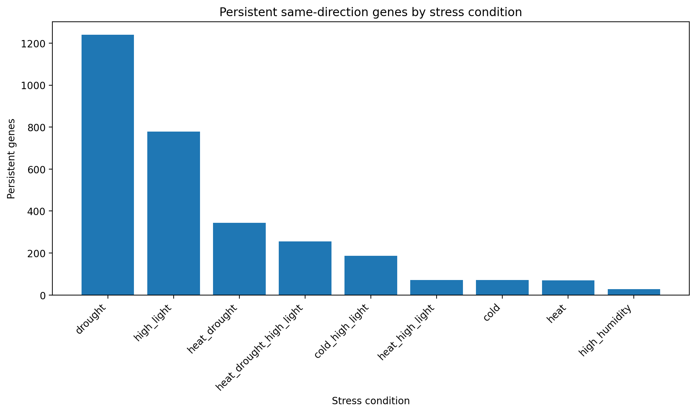
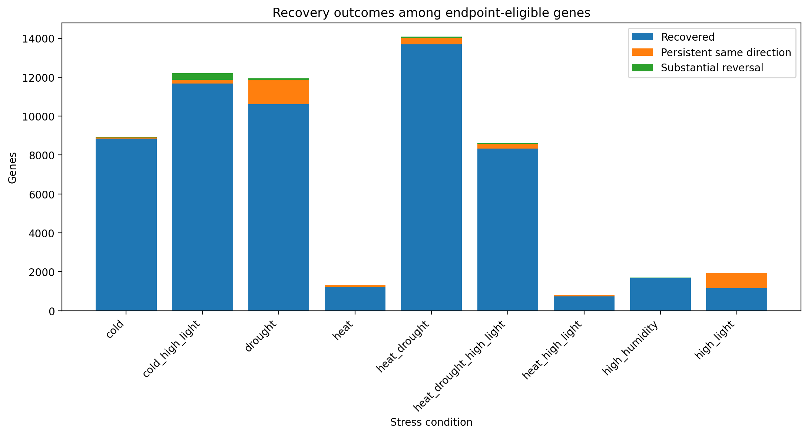

# Arabidopsis Stress Recovery Atlas — Generated Summary

This report is generated from the canonical SQLite analytical database.
It does not rerun or redefine the scientific classification rules.

## Dataset and analytical layer

- Samples: 57
- Informative genes: 26118
- Stress conditions: 9
- Gene-condition records: 235062
- Primary control-derived response floor: 0.342263

The response floor is an exploratory magnitude threshold derived from
control-to-control variation. It is not a differential-expression
significance threshold.

## Persistent recovery signal

Genes classified as `persistent_same_direction` retained a recovery
RNA-abundance shift beyond the primary response floor in the same
direction as their endpoint shift.

High-breadth genes persistent across at least four stress conditions:
**206**

### Recovery outcomes by condition

| condition | persistent_genes | recovered_genes | substantial_reversal_genes |
| --- | --- | --- | --- |
| drought | 1240 | 10613 | 89 |
| high_light | 779 | 1154 | 17 |
| heat_drought | 344 | 13690 | 54 |
| heat_drought_high_light | 255 | 8323 | 31 |
| cold_high_light | 187 | 11677 | 346 |
| heat_high_light | 72 | 729 | 13 |
| cold | 71 | 8838 | 6 |
| heat | 70 | 1226 | 14 |
| high_humidity | 28 | 1661 | 23 |

### Highest persistence breadth

| gene_id | persistence_breadth | n_persistent_up | n_persistent_down | short_description |
| --- | --- | --- | --- | --- |
| AT1G80160 | 8 | 8 | 0 | Lactoylglutathione lyase / glyoxalase I family protein |
| AT2G43570 | 8 | 8 | 0 | chitinase, putative |
| AT1G09500 | 7 | 7 | 0 | NAD(P)-binding Rossmann-fold superfamily protein |
| AT1G21250 | 7 | 7 | 0 | cell wall-associated kinase |
| AT1G21310 | 7 | 7 | 0 | extensin 3 |
| AT1G61800 | 7 | 7 | 0 | glucose-6-phosphate/phosphate translocator 2 |
| AT2G19900 | 7 | 7 | 0 | NADP-malic enzyme 1 |
| AT3G26830 | 7 | 7 | 0 | Cytochrome P450 superfamily protein |
| AT3G49120 | 7 | 7 | 0 | peroxidase CB |
| AT3G56710 | 7 | 7 | 0 | sigma factor binding protein 1 |
| AT4G01985 | 7 | 7 | 0 |  |
| AT4G12290 | 7 | 7 | 0 | Copper amine oxidase family protein |

The high-breadth definition is an operational project threshold and
should not be interpreted as a distinct biological gene class.

## Functional enrichment

Significant GO-Slim terms: **24**

Significant detailed Biological Process terms:
**45**

The complete significant-term table is available in
`tables/significant_go_terms.csv`.

GO enrichment describes over-represented annotations among the selected
gene set. It does not establish causal pathways or prove activation of
the biological processes named by the terms.

## Published recovery-DE comparison

Shared project/published gene-condition records:
**354**

Direction agreements after harmonizing the published fold-change
orientation:
**354 /
354**

| condition | shared_gene_records | direction_agreements | direction_agreement_percent |
| --- | --- | --- | --- |
| drought | 348 | 348 | 100 |
| cold | 2 | 2 | 100 |
| heat_drought | 2 | 2 | 100 |
| high_humidity | 1 | 1 | 100 |
| high_light | 1 | 1 | 100 |

This is a same-study methodological concordance check using available
published recovery-DE results. It is not independent biological
validation.

## Interpretation boundary

The project describes persistent residual RNA-abundance patterns after
stress removal. Persistent rlog-normalized expression should not be
interpreted by itself as evidence of continued transcription, protein
activity, causal stress memory, or a longitudinal response in the same
individual plants.
